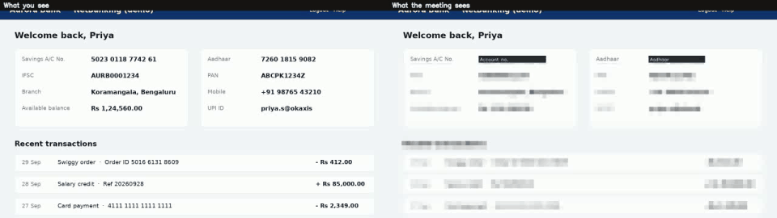
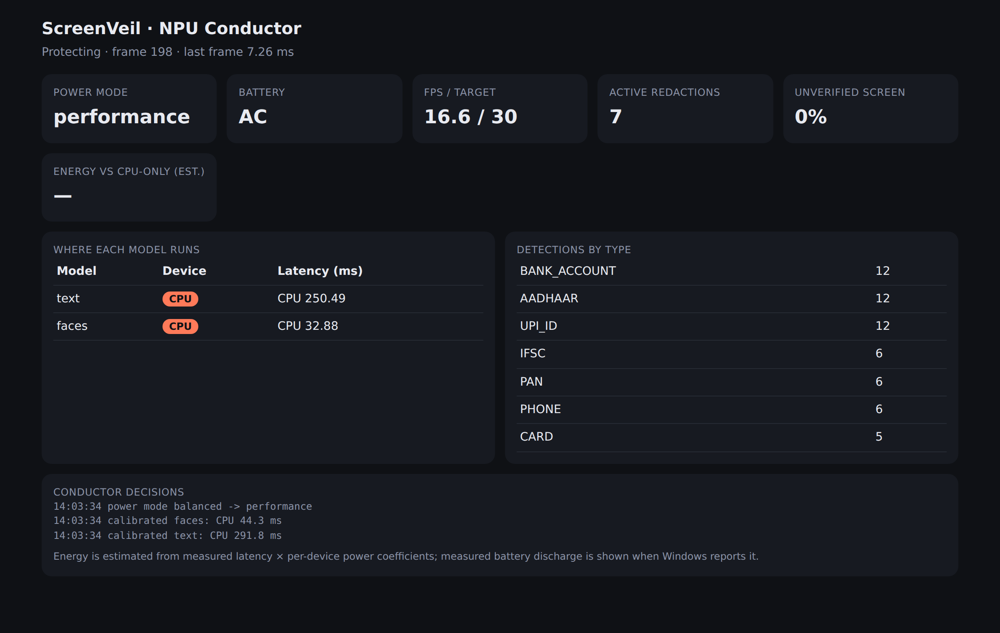

# ScreenVeil

**An on-device, fail-closed privacy shield for screen sharing, scheduled across the Snapdragon NPU, GPU and CPU by an adaptive "NPU Conductor".**

When you share your screen in Teams, Zoom or Meet, everything on it goes to everyone in the call: a bank page, an OTP notification, an API key in your editor, a client's name in a chat. ScreenVeil sits between your screen and the meeting. It reads every frame locally, finds sensitive content and paints over it *before the frame leaves the laptop*.



*Left: what you see. Right: what the meeting sees. Everything shown is synthetic demo data.*

---

## Why this has to run on the device

* **Privacy.** Sending your screen to a cloud AI in order to protect it would defeat the purpose. ScreenVeil makes no network calls, and its dashboard binds to `127.0.0.1` and serves numbers only, never pixels or text.
* **Latency.** Redaction has to keep up with a live video feed.
* **Battery.** A meeting can run for hours. An always-on vision workload is exactly what the Hexagon NPU on Snapdragon X-series PCs is built for.

## What it detects

| Category | Examples | How it avoids false alarms |
|---|---|---|
| Indian identity & banking | Aadhaar, PAN, IFSC, bank account, UPI ID, card number, CVV, OTP, phone | **Aadhaar must pass the Verhoeff checksum, cards must pass Luhn.** Account numbers, OTPs and CVVs need a nearby label ("A/C No.", "OTP"), even one in a separate column |
| Developer secrets | AWS / GitHub / Google / Slack / Stripe keys, JWTs, `password=…`, private-key headers, DB connection-string passwords, high-entropy tokens | Vendor-specific formats; entropy and character-class checks |
| Your own words | client names, project codenames (`--terms "Project Falcon"`) | Exact, case-insensitive |
| Faces | photos, ID cards, webcam previews on screen | Mosaic |

An order ID that merely *looks* like an Aadhaar number, a balance or a date stays visible, so the presentation stays usable.

## How it works

```
 screen ─► change & scroll tracker ─► dirty bands ─► NPU Conductor ─► OCR (NPU) ─► classifier ─► compositor ─► share this window
             (16 px cells, phase                       picks device,     CRAFT +      checksums,     paint-over,
              correlation)                             budget, mode      CRNN/CTC     context        mosaic pending
```

**1. Fail-closed by construction.** The screen is split into full-width horizontal *bands* (text runs horizontally, so a band never cuts a line in half). A 16 px cell grid tracks which pixels changed since they were last checked. **Any unchecked cell is mosaicked** until its band has been analysed. If the NPU is busy, throttled or crashes, the audience sees mosaic, never a leak. After repeated backend errors the whole screen is shielded.

**2. Work only where the screen changed.** Bands overlap by 96 px and each owns a "core" strip. Together the cores tile the screen exactly, so any text line up to 48 px tall is guaranteed to lie fully inside the band that verifies it. Unchanged bands are not re-analysed, apart from a slow background re-check of one band at a time.

**3. Scroll-aware.** Scrolling is the most common "everything changed" event. ScreenVeil detects it with phase correlation, refines the offset to the exact pixel, and moves both the redactions and the verified state along with the content. Only the newly revealed strip is analysed.

**4. Static shapes for the NPU.** Every band is letterboxed to one fixed detector input (default 256×1920), so a single compiled NPU graph serves every frame.

**5. Paint over, don't blur.** Blurred text can be partially recovered, a solid fill cannot. Redactions are labelled ("Aadhaar", "AWS key") so the audience knows something was deliberately hidden.

### The NPU Conductor

A scheduler that decides, every frame:

* **Where each model runs (NPU / GPU / CPU).** It measures each model on each device it supports at start-up (the ONNX OCR models: NPU/GPU/CPU; the face detector is CPU-only today), keeps a running latency average, re-checks placement periodically and on every power-mode change, and picks the device with the lowest *energy per inference* (latency × device power) that still fits the frame budget.
* **How hard the NPU works.** The power mode follows the battery (`performance` on AC → `balanced` → `saver` → `critical`), with hysteresis so the mode doesn't flap at a threshold. Each mode sets the QNN HTP performance mode (`burst` … `low_power_saver`), the target FPS, the number of bands analysed per frame, how often faces are checked, and the background re-verification rate.
* **Throttling.** A sustained latency rise on a device (thermal throttling or contention) is detected against its calibrated baseline, and the Conductor sheds load before frames are dropped. It recovers automatically.
* **Energy reporting.** The live dashboard (`http://127.0.0.1:8765`) shows mode, battery, measured discharge watts (Windows), per-model device and latency, and estimated energy saved against a CPU-only run.


*Dashboard screenshot from a CPU-only development machine. On a Snapdragon PC the Device column shows NPU.*

## Measured results

> **Status:** the full pipeline (tracking, classification, Conductor, compositor) is implemented and verified on CPU with the Tesseract fallback. The NPU path (EasyOCR ONNX models via ONNX Runtime QNN) is implemented and unit-tested at the pre/post-processing level; profile it with `tools/aihub_profile.py` and run it on a Snapdragon PC to confirm on-device figures.

In this repo's demo (127 frames: static page, 600 px smooth scroll, a notification popping up, switching apps):

| Metric | Result | Source |
|---|---|---|
| Model runs vs. analysing every band of every frame | **−88.8%** (57 vs 508) | `python tools/ablation.py` |
| Of which from scroll tracking alone | −57.8% (57 vs 135) | same |
| Sensitive items caught in the demo content | **14 / 14**, with 0 false positives on look-alikes (order ID, balances, dates, reference and toll-free numbers) | `python tools/eval_demo.py` |
| Unit tests | 34 passing | `python -m unittest discover -s tests -t .` |

**On Snapdragon:** Qualcomm's AI Hub model card for EasyOCR lists **38.2 ms (detector) and 20.1 ms (recogniser) on Snapdragon X Elite** at a 608×800 input ([source](https://huggingface.co/qualcomm/EasyOCR)). ScreenVeil's 256×1920 band has a similar pixel count. Run `tools/aihub_profile.py` to profile the exact band-shaped models; results go to `docs/aihub_profile.json`.

*For reference, the CPU-only Tesseract fallback takes roughly 180–220 ms per band in a 2-vCPU cloud container. That is the kind of cost the NPU path and the change-tracking exist to remove.*

## Quick start on Windows (about 10 minutes)

1. Install **Python 3.11 or newer** from python.org and tick "Add python.exe to PATH".
2. Install **Tesseract OCR** (CPU fallback) from https://github.com/UB-Mannheim/tesseract/wiki into its default folder. ScreenVeil finds it at `C:\Program Files\Tesseract-OCR` automatically; otherwise set `TESSERACT_CMD`.
3. In a terminal inside this folder:

```bat
py -m venv .venv
.venv\Scripts\activate
pip install -r requirements.txt
python -m unittest discover -s tests -t .      :: 35 tests should pass
python tools\eval_demo.py                      :: expect: total 14/14 PASS
python demo\render_demo.py                     :: writes demo\assets\demo_side_by_side.mp4
python -m screenveil devices                   :: shows NPU / GPU / CPU
python -m screenveil run --monitor 1           :: live; press q in the preview window to stop
```

Exact OCR results can vary slightly with the installed Tesseract version.

## Run it

Requirements: Python 3.10+ on Windows 11 (Snapdragon X-series recommended). It also runs on any Windows, macOS or Linux machine with the CPU fallback.

```bash
pip install -r requirements.txt
# Snapdragon PC: NPU runtime (native ARM64 Python recommended)
pip install onnxruntime-qnn

python -m screenveil devices                       # shows NPU / GPU / CPU availability
python -m screenveil run --window "Chrome" --terms "Project Falcon,Acme Corp"
```

Then **share the "ScreenVeil – share this window" window** in your meeting app, not your screen. Keep that window on a second monitor, or use `--window` to capture a single app, so the preview doesn't capture itself.

| Option | |
|---|---|
| `--window TITLE` / `--monitor N` | what to protect |
| `--terms "a,b"` | your confidential words |
| `--mode saver` | force a power mode (default: follow the battery) |
| `--virtualcam` | publish as a virtual camera (`pip install pyvirtualcam` + a virtual camera driver) |
| `--record out.mp4` | save the protected stream |
| `--power-profile docs/power_profile.json` | use measured watts (see below) |

Without an NPU, the same ONNX models run on the GPU or CPU through ONNX Runtime. If the model files are absent, ScreenVeil falls back to [Tesseract](https://github.com/tesseract-ocr/tesseract) OCR (`pip install pytesseract`).

## Put the models on the NPU (Qualcomm AI Hub)

```bash
pip install "qai-hub-models[easyocr]" qai-hub torch   # any PC with PyTorch
python tools/export_models.py                         # --source easyocr is an alternative source
qai-hub configure --api_token <token from aihub.qualcomm.com>
python tools/aihub_profile.py                         # compile + profile on a real Snapdragon X Elite
python tools/quantize.py                              # optional: uint16/uint8 QDQ model for the HTP
```

Copy `models/easyocr_detector.onnx` and `models/easyocr_recognizer.onnx` to the Snapdragon PC. `run` picks them up automatically and places them on the NPU through ONNX Runtime's QNN execution provider.
Set `SCREENVEIL_STRICT_NPU=1` to fail loudly if any operator would fall back to the CPU.

### Measure real power on your laptop

```bash
python tools/calibrate_power.py --seconds 60   # on battery; writes docs/power_profile.json
```

## Repository layout

```
screenveil/
  classify.py        sensitive-text rules, checksums, OCR normalisation, label context
  state.py           bands, cell grid, change + scroll tracking, fail-closed verification
  conductor.py       NPU Conductor: device placement, power modes, throttle detection, energy
  engine.py          per-frame pipeline
  redact.py          paint-over / mosaic compositor
  backends/          ONNX Runtime (QNN/DML/CPU) OCR, Tesseract fallback, faces
  dashboard.py       local-only live telemetry page
tools/               AI Hub export + profiling, quantisation, power calibration, ablation
demo/                synthetic demo screens and video renderer
tests/               34 unit tests
```

## Limits and next steps

* Face detection currently uses OpenCV's classical detector on the CPU. A MediaPipe face model from AI Hub on the NPU is the next workload for the Conductor.
* Text taller than 48 px (very large headings) can straddle a band boundary. A coarse-scale pass for large text is planned.
* Non-Latin scripts (Hindi and others) need a matching recogniser and character set.
* Planned: per-app policies (e.g. always hide the mail client's preview pane), and handwriting or photos of documents via the webcam.

## License

MIT, see [LICENSE](LICENSE). Uses ONNX Runtime (MIT), OpenCV (Apache-2.0) and EasyOCR models via Qualcomm AI Hub Models (see their licenses).
